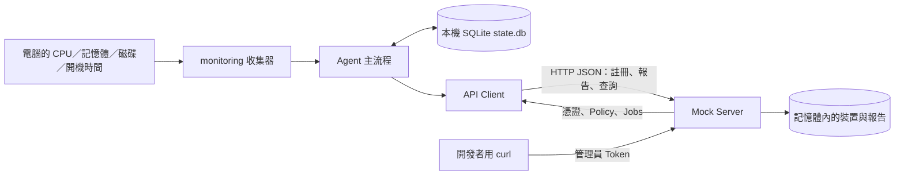

# Kiosentra 程式導讀：依家個 App 點樣運作

> 歷史文件：以下內容描述 2026-11-03 嘅 Phase 1／2，並非目前完成度。
> Central server、web admin、本機 UI 同憑證續期等已於之後實作。
> 最新狀態請睇 [README](README.md)、[驗證紀錄](docs/development/validation.md)
> 同[後續開發 phases](docs/development/roadmap.md)。

本文以 **2026-11-03 工作目錄內的原始碼**為準，寫畀未學過 Go 的讀者。目的係解釋現有程式點啟動、各部分有咩關係、資料點流動，以及目前做到邊度。這次是原始碼閱讀及文件整理，沒有啟動你現有的 Agent、讀取本機私密狀態，亦沒有重新執行測試；文中的指令供你自行操作。

## 1. 先認識依家真正有咩

Kiosentra 想做的是 kiosk（自助服務機）的裝置管理系統。目前完成的是 Phase 1／2 基礎：一個裝在裝置上的 **Agent**，定時讀取電腦狀態，再向中央伺服器報告。

現階段可執行的程式有兩個：

| 部分 | 可以點理解 | 現況 |
| --- | --- | --- |
| Go Agent | 每部 kiosk 上的駐機程式，負責收集及上報 | 已實作，可用 console 或 Windows Service 模式執行 |
| Mock Server | 開發時扮演中央伺服器，接收報告及派測試工作 | 已實作，只接受本機連線，資料存在記憶體 |
| 正式 Central Server | 未來管理大量裝置、長期保存資料的後端 | `apps/server` 目前只有預留說明 |
| Web Admin | 管理員在瀏覽器用的控制台 | `apps/admin` 尚未實作 |
| Agent 本機 UI | kiosk 上顯示的本機操作介面 | `apps/agent/frontend` 尚未實作，規劃用 Wails／React |

所以依家執行後，主要見到的是 terminal log 同 JSON 資料，唔會彈出視窗，亦沒有可用的網頁 dashboard。目錄存在不代表功能已經完成。

## 2. 各部分的關係



重點是 **Agent 主動連去 Server**。Server 不會直接連入 Agent，也沒有已實作的 WebSocket 推送。Agent 定期問：「有冇新 policy？有冇工作畀我？」這種方式叫 polling（輪詢）。

SQLite 是 Agent 的本機資料庫，直接是一個檔案，毋須另外開一個 database server。Mock Server 則沒有使用這個 SQLite；兩邊的儲存完全分開。

### 原始碼依賴與執行時連線是兩回事

```text
編譯時：
Agent ────────────> packages/contracts
Mock Server ──────> packages/contracts
Agent 整合測試 ───> Mock Server 的 handler

執行時：
Agent 程序 ── HTTP 請求 ──> Mock Server 程序
```

`contracts` 是雙方共用的資料格式，例如 Heartbeat 有哪些欄位、Job 長甚麼樣。它是一個程式庫，不是第三個要啟動的服務。Agent 的 `go.mod` 亦引用 Mock Server，是為了整合測試；正常啟動 Agent 不會順便開 Server。

## 3. 未識 Go，可以點睇這個專案

| Go 名詞／寫法 | 在這個專案的意思 |
| --- | --- |
| `package` | 一組有關聯的程式碼，例如 `storage` 專門處理本機資料 |
| `package main`、`func main()` | 可執行程式的入口，類似「由這裡開始」 |
| `import` | 引入其他 package 的功能 |
| `go.mod` | 一個 module 的名稱、Go 版本與依賴清單 |
| `go.sum` | 依賴內容的校驗資料；版本要求主要在 `go.mod` |
| `go.work` | 將這個 repository 的三個本機 module 一起開發 |
| `struct` | 一組有名稱的欄位，例如 `Config` 裝住設定 |
| `func (a *Agent) Cycle(...)` | 屬於 Agent 的方法；`a` 就是正在處理的 Agent 物件 |
| `*Agent` | 指向 Agent 的指標，方法可以修改同一份 Agent 狀態 |
| `interface` | 要求實作者提供指定方法，例如收集器必須有 `Collect` |
| `value, err := ...` | 一次接收結果及錯誤；`:=` 同時宣告變數 |
| `if err != nil` | 如果有錯，就處理或回傳；`nil` 在這裡代表沒有錯誤 |
| `defer` | 當函式離開時做清理，例如關閉資料庫、釋放鎖 |
| `context.Context` | 將「請停止」或「已超時」的訊號傳入下層操作 |
| `go func() { ... }()` | 啟動 goroutine，讓一段工作可以並行執行 |
| `channel`、`select` | 傳遞訊息，以及等待停止訊號、timer 或工作結果 |
| `_test.go` | 測試用程式，不是正式啟動流程的一部分 |
| `//go:build windows` | 編譯 Windows 版本時才包含這個檔案 |

`internal` 目錄亦有 Go 的匯入範圍限制：Agent 的內部實作不是給任意外部 module 直接使用，所以跨程式共用的資料型別放在 `packages/contracts`。

`go run` 會編譯並立即執行；`go build` 會產生可執行檔。使用編譯好的 Agent 時，不需要再靠 `go run`。目前沒有自動監察原始碼改動的開發熱重載。

## 4. 目錄地圖：應該去邊個檔案睇

| 路徑 | 責任 |
| --- | --- |
| [Agent main.go](apps/agent/cmd/kiosentra-agent/main.go) | 處理啟動參數、log、console／service 分流及停止訊號 |
| [app.go](apps/agent/internal/app/app.go) | 核心協調者：初始化、採樣、註冊、同步、重試、拒絕工作 |
| [config.go](apps/agent/internal/configuration/config.go) | 讀取環境變數，驗證 URL、目錄和時間設定 |
| [basic.go](apps/agent/internal/monitoring/basic.go) | 用 gopsutil 讀取真實系統指標 |
| [client.go](apps/agent/internal/api/client.go) | 將 Go 資料轉成 JSON，送 HTTP 請求，處理回應 |
| [store.go](apps/agent/internal/storage/store.go) | SQLite 資料表、待送佇列、工作紀錄 |
| [protector.go](apps/agent/internal/storage/protector.go) | 開發環境用的 AES-GCM 加解密及 Protector 介面 |
| [protector_windows.go](apps/agent/internal/storage/protector_windows.go) | Windows 的 DPAPI 憑證保護 |
| [lock.go](apps/agent/internal/storage/lock.go) | 阻止兩個 Agent 同時使用同一狀態目錄 |
| [service_windows.go](apps/agent/internal/service/service_windows.go) | 接駁 Windows Service Control Manager（SCM） |
| [types.go](packages/contracts/types.go) | 共用資料型別、驗證規則、嚴格 JSON 解碼 |
| [openapi-v1.yaml](packages/contracts/openapi-v1.yaml) | HTTP API 的規格文件 |
| [Mock main.go](tools/mock-server/cmd/mock-server/main.go) | 啟動本機 HTTP Server |
| [Mock server.go](tools/mock-server/mock/server.go) | 註冊、驗證、接收報告、提供測試工作 |

`inventory`、`deployment`、`updater`、`watchdog`、`ipc` 等目錄目前是未來功能的預留位置。現時 job 的拒絕邏輯寫在 `app.go`，不是 `internal/jobs` 裡面。

## 5. 啟動 Agent 後，第一秒發生甚麼

入口在 `apps/agent/cmd/kiosentra-agent/main.go`。可以沿住以下路線讀：

```text
main()
  └─ run()
      ├─ 解析 --mode、--version
      ├─ 建立 logger 及停止訊號處理
      └─ app.Run(ctx, log)
          ├─ configuration.Load()
          ├─ 建立狀態目錄、取得 agent.lock
          ├─ 選擇平台加密器
          ├─ storage.Open() 開啟 SQLite
          ├─ New() 組合 Config／Store／Client／Collector／Logger
          └─ Agent.Run()
              ├─ Initialize()
              └─ 重複 Cycle()
```

`--version` 只印版本就離開；`--mode=ui` 會明確回報 UI 尚未完成。預設是 `console`。

初始化時，Agent 會：

1. 保存不含秘密的有效設定快照，方便診斷；之後啟動仍由環境變數載入設定，不是由快照還原設定。
2. 將這個狀態目錄綁定到 Server URL。之後改用另一個 URL，會拒絕啟動，避免把舊憑證送錯地方。目前是比較設定字串，並非完整的 URL 正規化比較。
3. 從 SQLite 讀取裝置 identity；如果不存在，就產生 Ed25519 公鑰和私鑰，再加密保存。
4. 讀取之前取得的 device credential，交給 API Client 使用。
5. 印出 `agent started`，立即執行第一輪，再等定時器。

因此 `agent started` 代表本機初始化成功，**不代表已連上 Server**。首次註冊成功才會見到 `device enrolled`。

## 6. 每一輪 Cycle 做甚麼

預設間隔 30 秒，第一輪立即開始。採樣與同步在同一個主迴圈內依次執行，沒有獨立的背景採樣 worker；網絡慢會拖長這一輪，30 秒不是每輪一定準時完成的保證。

### 6.1 先讀取本機狀態，寫入待送佇列

`sample()` 呼叫 `Collector.Collect()`，現時實作者是 `monitoring.Basic`：

| 資料 | 實際量度內容 |
| --- | --- |
| CPU | 約 250 毫秒採樣窗口內的整體 CPU 使用率 |
| Memory | 整部電腦的記憶體總量與已使用量 |
| Disk | 狀態目錄所在磁碟／檔案系統的總量與已使用量 |
| Uptime | 作業系統開機後經過的秒數，不是 Agent 執行時間 |
| Processes | 現時是空陣列，未做逐個程序監控 |
| KioskRunning | 現時是 `null`，表示不知道 kiosk 程序是否正在運作 |

成功時先把 metrics 放入 SQLite `outbox`，再放入 heartbeat。Heartbeat 包含版本、狀態、uptime、健康資訊等；`lastActivity` 現時是當輪建立 heartbeat 的時間，不能當成使用者最後操作 kiosk 的時間。

如果收集器回報錯誤，該輪不排入 metrics，會嘗試排入 `status=degraded`、`health=metrics_unavailable` 的 heartbeat。如果驗證或入隊本身失敗，`sample()` 可能提前返回，所以不是任何錯誤情況都一定有 heartbeat。

### 6.2 再決定可否同步

如果上一輪網絡失敗，且尚未到 `nextAttempt`，這輪會略過同步，但仍已嘗試採樣入隊。

可以同步時，`sync()` 按以下次序工作：

1. **首次註冊**：沒有 access token 才呼叫 enrollment API；得到憑證後，先加密保存，再供 Client 使用。
2. **檢查憑證到期日**：已到期就停止這輪同步。目前不會自動更新憑證。
3. **送出舊報告**：依入隊先後取最多 100 筆 outbox，一筆一筆送，成功一筆才刪一筆。
4. **取得 policy**：驗證格式後放進本機 `kv`。目前只快取，不套用到電腦，也不會用 policy 內的 interval 改變現有 ticker。
5. **取得 jobs**：每頁最多 100 筆，每輪最多讀 10 頁，並檢查重複分頁游標。
6. **保存拒絕決定**：所有工作都拒絕；通常原因是 `job execution is disabled in Phase 2`，已過期工作則記錄租約過期。
7. **回報 ACK**：取最多 100 個未回報決定，送出 `accepted=false`，成功後標記已回報。若 Server 回 404／410，亦會視作工作已不存在而完成本機回報標記。

其中一步出錯，這次 `sync()` 就返回，後面的步驟不會繼續。因此一筆持續被 Server 拒絕的 outbox 報告，可以連帶阻塞後面的報告、policy 更新及 job polling。

### 6.3 失敗後點重試

`Backoff()` 用指數增長加隨機延遲：第一次大約 1 至不足 3 秒，連續失敗後逐步加長，最高約 1 至不足 257 秒。隨機部分用來避免很多 Agent 同一時間重試。

這個延遲只是設定「最早幾時可以再試」，沒有另開 timer 即刻重試；仍要等下一輪 Cycle。例如 interval 是 30 秒，即使 log 寫 retry 約 2 秒，通常也要等下一輪先再試。

單輪同步錯誤會記 warning，主迴圈繼續；初始化失敗則直接退出。成功同步會清除累計失敗次數。

## 7. 本機 SQLite 保存甚麼，點解要保存

狀態目錄主要有 `state.db`、SQLite 可能建立的 `state.db-wal`／`state.db-shm`，以及程序鎖檔 `agent.lock`。Service 模式另有 log 檔。

| 資料表 | 內容 | 用途 |
| --- | --- | --- |
| `kv` | configuration、server-origin、identity、credential、policy | 保存設定快照、身份與快取 |
| `outbox` | event ID、HTTP method、path、JSON body、順序編號 | 網絡未成功時留住待送資料 |
| `jobs` | 工作內容、拒絕決定、reported 標記 | 重啟後仍記得處理過甚麼工作 |

SQLite 開啟 WAL 和 `synchronous=FULL`，用交易處理入隊。它有助於資料可靠落盤；但備份時仍要考慮 WAL，不能假設運行中只複製 `state.db` 就完整。

只有標記為 secret 的 `identity` 和 `credential` 值會經 Protector 加密，**不是整個 SQLite 檔案加密**。Telemetry、policy 和 job 紀錄沒有在這層加密。

`outbox` 預設最多 1,000 筆，滿了就拒絕新資料並記 warning，保留舊資料。一輪通常兩筆，完全離線、由空佇列開始、每 30 秒成功採樣的情況下，大約 250 分鐘就會滿；這是估算，不是無限離線保存。

Jobs 紀錄最多 10,000 個 ID，已回報的也保留以防重複處理。目前沒有自動清理機制，滿了就不接受新的 job 紀錄。

### 避免「Server 收到，但 Agent 唔知」造成重複

假設 Server 已收了一筆 metrics，但網絡在回覆途中斷了。Agent 看不到成功回覆，SQLite 會保留該筆，下次重送。

每筆 outbox 在入隊時已有固定 ID，重試會把同一 ID 放進 `Idempotency-Key` HTTP header。Mock 會比對同一裝置、method、path、ID 的回條及內容雜湊：內容一樣就回傳舊結果，內容不一樣則回 409。這是應用層的防重複機制，不代表網絡只傳送一次。

Mock 的防重複紀錄在記憶體，有數量上限；它不是長期可靠的正式後端。

## 8. 註冊、Token、加密 Key 有咩分別

| 名稱 | 誰使用 | 做甚麼 |
| --- | --- | --- |
| Enrollment token | Agent 首次向 Mock 註冊時 | 證明允許這部裝置加入，兩邊設定必須一致 |
| Device access token | 註冊後的 Agent | 放進 `Authorization: Bearer ...`，作日常 API 驗證 |
| Mock admin token | 開發者的 curl | 查看 `/dev/state`、建立 `/dev/jobs`，必須與 enrollment token 不同 |
| Development key | 非 Windows 開發用 Agent | 加解密 SQLite 裡的 identity／credential，不是登入 Server 的 token |
| Ed25519 公私鑰 | Agent identity | 公鑰用於註冊識別；目前日常請求靠 Bearer token，沒有逐次私鑰簽署請求 |

Mock 要求 enrollment token 及 admin token 各至少 16 個字元，而且不能相同。它簽發的 device credential 有效期為 24 小時。

Windows 使用與執行帳戶相關的 DPAPI；同一個 state directory 不應由不同帳戶混用。macOS／Linux 的目前實作必須開 development mode，並提供 Base64 編碼的 32-byte AES key。

HTTP 只允許顯式 development mode 加 literal loopback IP，例如 `http://127.0.0.1:8080`；`http://localhost:8080` 不符合目前驗證規則。一般連線要求 HTTPS，Client 驗證 TLS 憑證並拒絕自動跟隨 redirect。

## 9. API 關係：有接口不等於主流程有使用

以下路徑除 `/dev/...` 外，都有 `/api/v1` 前綴，由 Client 自動加上。

| API | 目前 Agent 主流程會否呼叫 |
| --- | --- |
| `POST /enrollments` | 會，沒有已存 access token 時 |
| `POST /agent/metrics` | 會，從 outbox 發送 |
| `POST /agent/heartbeat` | 會，從 outbox 發送 |
| `GET /agent/policy` | 會，快取結果 |
| `GET /agent/jobs` | 會，輪詢工作 |
| `POST /agent/jobs/{id}/ack` | 會，只回報拒絕 |
| `PUT /agent/inventory` | 尚未自動呼叫 |
| `POST /agent/credentials/rotate` | 尚未自動呼叫 |
| `POST /agent/jobs/{id}/status`、`renew` | 尚未用來執行工作 |
| `POST /agent/policy/report` | 尚未自動呼叫 |
| `GET /agent/releases/latest`、`POST /agent/update-status` | 尚未有自動更新流程 |
| `GET /dev/state` | 給開發者查看 Mock 收到的報告，不是 Agent 使用 |
| `POST /dev/jobs` | 給開發者製造測試工作，不是正式管理 API |

共用 `contracts` 會檢查必要欄位、拒絕未知欄位、限制 JSON 大小等。這減少兩邊理解不一致，但不會自動實作 OpenAPI 中描述的業務功能。

## 10. 在 Mac 本機點樣 run

以下全部在 repository 根目錄執行。專案 README 要求 Go 1.26.10 或受支援的較新 1.26／1.27 patch；`go.mod` 本身寫的是 `go 1.26.0`。這裡轉述專案版本要求，並非另外查證最新 Go 發行版本。

### Terminal 1：啟動 Mock Server

```sh
export KIOSENTRA_MOCK_ENROLLMENT_TOKEN='kiosentra-local-enrollment-change-me'
export KIOSENTRA_MOCK_ADMIN_TOKEN='kiosentra-local-admin-change-me'
go run ./tools/mock-server/cmd/mock-server
```

預設監聽 `127.0.0.1:8080`。以上是本機示範 token；如果改值，下面對應設定亦要一起改。保留這個 terminal 運作。

### Terminal 2：啟動 Agent

```sh
export KIOSENTRA_SERVER_URL='http://127.0.0.1:8080'
export KIOSENTRA_DEVELOPMENT=true
export KIOSENTRA_ENROLLMENT_TOKEN='kiosentra-local-enrollment-change-me'

# 第一次建立新狀態時產生 key；沿用舊狀態時必須沿用同一條 key。
export KIOSENTRA_DEVELOPMENT_KEY="$(openssl rand -base64 32)"
export KIOSENTRA_STATE_DIR="$(mktemp -d "${TMPDIR:-/tmp}/kiosentra-dev.XXXXXX")"
printf 'State directory: %s\n' "$KIOSENTRA_STATE_DIR"

go run ./apps/agent/cmd/kiosentra-agent --mode=console
```

這裡每次執行整段都建立新 key、新狀態目錄及新身份，不會覆蓋既有 `.local-state`。臨時目錄日後可能被作業系統清理。若要跨 terminal 長期沿用這份狀態，須自行妥善保留原 key 及目錄路徑；只保留 SQLite 不足以解密。

首次連線成功通常見到 `agent started`、`device enrolled`。成功的每筆 heartbeat 不會逐筆印出 log，所以沒有新 log 不等於停止運作。

### Terminal 3：查看 Server 已收到的資料

```sh
export KIOSENTRA_MOCK_ADMIN_TOKEN='kiosentra-local-admin-change-me'
curl --fail --silent --show-error \
  -H "Authorization: Bearer $KIOSENTRA_MOCK_ADMIN_TOKEN" \
  http://127.0.0.1:8080/dev/state | python3 -m json.tool
```

這裡 `python3` 只用來排版 JSON，不是 Agent 的執行依賴。結果是一個裝置陣列，內有 `deviceId`、`reports`、`jobs`。Reports 的 path 可分辨 metrics 與 heartbeat；API 不會把裝置 access token 放入這個檢視結果。

### 停止、重開及編譯

按 Ctrl+C 會傳入取消訊號，Agent 結束主流程並關閉 DB、釋放程序鎖。

只重開 Agent 時，在同一 Terminal 2 重跑最後一行 `go run ...` 即可，保持環境變數不變，就會沿用身份及待送資料。若 Mock 也重開，請重新執行 Terminal 2 的整段，建立新的開發狀態。

原因是 **Agent 的資料在磁碟，但 Mock 的裝置註冊在記憶體**。Mock 重開會忘記舊裝置；Agent 有舊 token 時不會自動重新 enrollment，所以會持續收到認證失敗。

要產生可重複使用的執行檔：

```sh
go build -o bin/kiosentra-agent ./apps/agent/cmd/kiosentra-agent
go build -o bin/mock-server ./tools/mock-server/cmd/mock-server
```

之後在各自已設定環境變數的 terminal，分別用 `./bin/mock-server`、`./bin/kiosentra-agent --mode=console` 取代 `go run`。修改原始碼後需要重新 build。

## 11. 設定從哪裡來

目前讀取的是環境變數，沒有自動載入 `.env` 或 YAML 設定的程式。

| 變數 | 預設／用途 |
| --- | --- |
| `KIOSENTRA_SERVER_URL` | 預設 `https://localhost:8443`；不會自動啟動該位址的 Server |
| `KIOSENTRA_STATE_DIR` | 必須是絕對路徑；Windows 預設在 `%ProgramData%\Kiosentra`，其他系統在使用者設定目錄下的 `kiosentra` |
| `KIOSENTRA_ENROLLMENT_TOKEN` | 首次註冊需要；有可用的已存 credential 後，不靠它做日常認證 |
| `KIOSENTRA_DEVELOPMENT` | 預設 false；本機 HTTP、非 Windows 開發儲存需要 true |
| `KIOSENTRA_DEVELOPMENT_KEY` | 非 Windows 開發儲存用的加密 key |
| `KIOSENTRA_INTERVAL` | 預設 `30s`，可用 `5s`、`1m` 等格式；允許 1 秒至 1 小時 |

`RequestTimeout=10 秒`、`MaxQueue=1000` 是目前 `Load()` 內的預設值，沒有對應環境變數可直接覆寫。HTTP timeout 是每個請求的限制，不是整輪同步的總時限；收集器亦使用一個同樣長度的 context timeout。

## 12. Windows Service 與 console 有咩關係

兩個模式共用同一套 `app.Run()`。差異主要是由誰啟動、怎樣接收停止訊號，以及 log 寫到哪裡。

| 項目 | Console | Windows Service |
| --- | --- | --- |
| 啟動者 | 使用者在 terminal 啟動 | Windows SCM 啟動 |
| 停止方式 | Ctrl+C／SIGTERM | SCM Stop／Shutdown |
| Log | stderr，通常在 terminal 顯示 JSON | 狀態目錄的 `agent.log` |
| Log 輪替 | 此程式沒有替 console 輸出輪替 | 約 5 MiB 輪替，保留目前及上一份 `.1` |
| 平台 | Windows；macOS／Linux 作開發用途 | 只限 Windows，亦不能當普通 console 直接啟動 |

Service adapter 用 goroutine 跑核心，自己等待 Windows 控制訊號。停止時取消 context，最多等待約 25 秒，再向 SCM 回報結果。

Service 不會自動繼承你在 PowerShell 設的環境變數，必須另外 provision。DPAPI 與帳戶相關，所以登入使用者的 console state 不應直接拿給 LocalSystem Service 使用。具體操作見 [Windows Service 指南](docs/deployment/windows-service.md)。

有 Service adapter 不等於已有 installer、自動部署或原生 Windows 驗證完成；跨平台編譯成功亦不能證明 Windows 帳戶、權限及開機恢復都正常。

## 13. 常見現象點理解

| 現象／錯誤 | 原因與處理方向 |
| --- | --- |
| 啟動後沒有 GUI | UI 未實作，用 log 及 `/dev/state` 查看 |
| `invalid_enrollment_token` | Agent 與 Mock 的 enrollment token 不一致 |
| `invalid_device_credential` | 常見於 Mock 重開後使用舊 state；建立新的開發狀態 |
| `cipher: message authentication failed` | 用了不同 development key 開舊 state；恢復原 key 或用新的開發 state |
| `another agent owns this state directory` | 已有另一個 Agent 鎖住同一目錄；先停止那個實例 |
| `server origin differs from enrolled state` | 這個 state 綁定了不同 Server URL；用對應 URL 或獨立 state |
| `central sync failed` | 查看同一行 error，可能是連線、認證、資料驗證或佇列送出失敗 |
| `telemetry queue is full` | 未送資料已滿，新採樣無法保存；要解決同步問題 |
| 憑證過期後不再上報 | 尚未自動 rotation；開發環境可重新建立 state 註冊 |
| 收到 job 卻不安裝軟件 | 現階段所有 job 都會被拒絕，是目前設計行為 |

## 14. 現有測試與閱讀順序

現有測試涵蓋設定邊界、TLS／redirect、取消請求、SQLite 加密與持久性、佇列上限、程序鎖、離線重啟、遺失回覆後重送、job 拒絕，以及 Mock 的認證／租約／防重複規則。Windows DPAPI 另有平台專用測試。

這個 repository 是多 module workspace，從根目錄測試請明確列出三個 module：

```sh
go test ./apps/agent/... ./packages/contracts/... ./tools/mock-server/...
```

不要直接假設 `go test ./...` 在 workspace 根目錄會測齊三個 module。[scripts/check.sh](scripts/check.sh) 另包含 race test、vet、一般 build 及 Windows cross-build。這次文件整理沒有重新跑這些檢查，歷史驗證可參考 [validation.md](docs/development/validation.md)。

初次閱讀建議依次看：

1. `cmd/kiosentra-agent/main.go`：認識入口及模式。
2. `internal/app/app.go`：先看最底的 `Run`，再看 `Agent.Run`、`Initialize`、`Cycle`、`sample`、`sync`。
3. `configuration/config.go`：認識設定從哪裡來。
4. `monitoring/basic.go`：看數據如何產生。
5. `storage/store.go`：看數據如何留在本機。
6. `api/client.go` 與 `contracts/types.go`：看資料怎樣變成 HTTP JSON。
7. `tools/mock-server/mock/server.go`：看對面如何驗證及接收。
8. `internal/app/integration_test.go`：看離線、重啟及拒絕工作的完整情境。

閱讀後續功能時，以「有沒有從目前啟動入口一路呼叫到它」判斷是否已啟用。現有主線是：**啟動 → 載入本機身份 → 採樣入隊 → 註冊／認證 → 送報告 → 快取 policy → 取工作並拒絕 → 等下一輪**。
